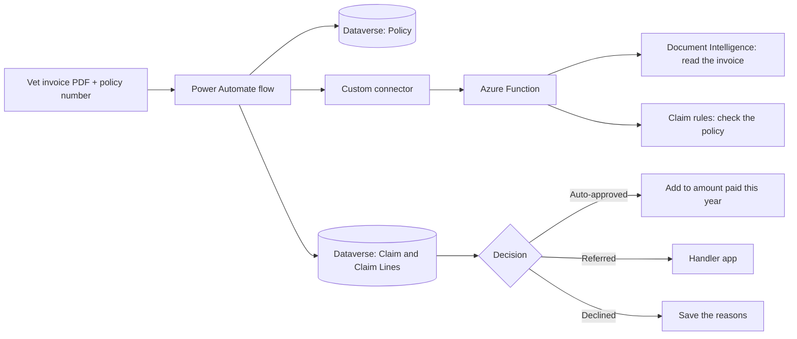

# Pet Insurance Claims AI

Automating pet insurance vet invoice claims with **Azure Document Intelligence**, **Azure Functions** and **Power Platform**, with a human handler reviewing any claim the system isn't sure about.

A pet owner sends in a vet invoice. The system reads the invoice, checks it against the pet's insurance policy, and makes one of three decisions:

| Decision | What happens |
| --- | --- |
| **Auto-approved** | The claim is paid automatically, and the policy's yearly total is updated |
| **Referred** | A claims handler checks it in a review app |
| **Declined** | There is nothing to pay (for example, only routine care was claimed) |

> All invoices, policies and names in this repo are fictional test data.

## Why this project

Real vet invoices come from thousands of vet practices, and each practice uses its own layout. So this project tests **one ready-made model** (Document Intelligence `prebuilt-invoice`, no training) against **8 different invoice layouts**, including a scanned page and a two-page invoice.

It also shows that **reading an invoice correctly is not enough** in insurance. A perfectly read invoice can still be for the wrong pet, too early in the policy, or for treatment that isn't covered. Policy rules decide the result.

## Architecture



1. A Power Automate flow starts with a vet invoice (PDF) and a policy number.
2. The flow finds the policy in Dataverse.
3. The flow sends the invoice and the policy details to an Azure Function, through a custom connector.
4. The Function reads the invoice with Document Intelligence, then checks it against the policy rules, and returns a decision with reasons.
5. The flow saves the claim, its lines and the PDF in Dataverse.
6. Referred claims appear in a model-driven app, where a handler makes the final decision. Every change is audited.

**Design choice:** the rules involve maths (VAT, excess, yearly limits), which is hard to write and test in Power Automate. So Python does the reading and the checking, and Power Automate only runs the process and saves the data.

## Claim rules

The rules live in [`pet_claims_function/claim_rules.py`](pet_claims_function/claim_rules.py). They have no Azure code, so they can be unit tested on a laptop.

| Check | If it fails |
| --- | --- |
| Is the extraction confidence at least 0.8? | Refer to a handler |
| Is the insured pet's name on the invoice? | Refer to a handler |
| Was the treatment at least 14 days after the policy started (waiting period)? | Refer to a handler |
| Is each line covered? Vaccinations, flea and worm treatment, microchips, neutering, routine teeth cleaning and grooming are not. | Mark that line as excluded |
| Do the lines add up to the invoice total (VAT added or VAT inclusive)? | Refer to a handler |
| Is the amount to pay over £500? | Refer to a handler |
| Is there anything left to pay after the excess and the yearly limit? | Decline if not |

**Amount to pay** = covered lines (including VAT), minus the excess, but never more than what is left of the yearly limit.

**How the pet's name is checked:** the invoice model doesn't return the pet's name, because it isn't a standard invoice field. But the name is already known from the policy, so the Function simply checks whether it appears anywhere on the invoice text.

## Repository contents

| Path | What it is |
| --- | --- |
| `function_app.py` | Entry point for the Functions host (loads the app from `pet_claims_function/`) |
| `pet_claims_function/function_app.py` | The HTTP endpoint `POST /api/process-vet-claim`: reads the invoice, then applies the rules |
| `pet_claims_function/claim_rules.py` | The claim rules, in plain Python |
| `pet_claims_function/test_rules.py` | 8 unit tests for the rules (no Azure needed) |
| `pet_claims_function/test_claims.py` | End-to-end test: sends all 8 invoices to the Function and compares with the expected results |
| `pet_claims_connector.yaml` | OpenAPI definition for the Power Platform custom connector |
| `sample_vet_invoices/` | 8 sample vet invoices, each with a different layout |
| `policies.csv` | 5 test policies to load into Dataverse |
| `expected_outcomes.json` | The expected decision for each invoice |

## Test data

**Policies**

| Policy | Pet | Start date | Yearly limit | Excess | Paid so far |
| --- | --- | --- | --- | --- | --- |
| PET-10001 | Biscuit (dog) | 1 Nov 2025 | £4,000 | £99 | £0 |
| PET-10002 | Milo (cat) | 15 Feb 2026 | £3,000 | £99 | £2,980 |
| PET-10003 | Bella (dog) | 10 Sep 2026 | £5,000 | £120 | £0 |
| PET-10004 | Luna (cat) | 1 Jun 2025 | £4,000 | £99 | £0 |
| PET-10005 | Max (dog) | 20 Mar 2025 | £6,000 | £150 | £400 |

**Invoices and expected results** (if the invoice is read correctly)

| Invoice | Layout | Policy | Total | Expected | Why |
| --- | --- | --- | --- | --- | --- |
| 01 Riverside | Classic table | PET-10001 | £121.68 | Auto-approved (£22.68) | Normal claim, minus £99 excess |
| 02 Oakwood | Coloured sidebar | PET-10004 | £532.20 | Auto-approved (£91.20) | Routine teeth cleaning excluded |
| 03 Greenfields | Two pages, 16 lines | PET-10005 | £2,791.32 | Referred | Over the £500 auto-approve limit |
| 04 Paws & Claws | Till receipt, VAT inclusive | PET-10002 | £135.60 | Auto-approved (£20.00) | Only £20 left of the yearly limit |
| 05 St Margaret's | Scanned, skewed, noisy | PET-10001 | £174.00 | Auto-approved or Referred | Depends on how well the scan is read |
| 06 Hillcrest | Letterhead | PET-10003 | £393.60 | Referred | Treatment 6 days after the policy started |
| 07 Meadowbank | Plain text | PET-10001 | £104.40 | Declined | Vaccination and flea treatment not covered |
| 08 Thameside | Landscape | PET-10004 | £89.76 | Referred | Invoice is for Rocky, the policy is for Luna |

## Run it locally

**You need:** Python 3.12, Azure Functions Core Tools v4, and an Azure Document Intelligence resource (the free F0 tier is enough).

```bash
python3.12 -m venv .venv
source .venv/bin/activate
pip install -r requirements.txt
```

Create `local.settings.json` (it is git-ignored):

```json
{
  "IsEncrypted": false,
  "Values": {
    "AzureWebJobsStorage": "UseDevelopmentStorage=true",
    "FUNCTIONS_WORKER_RUNTIME": "python",
    "DI_ENDPOINT": "https://<your-resource>.cognitiveservices.azure.com/",
    "DI_KEY": "<your key>"
  }
}
```

**1. Test the rules (no Azure needed).** From the repo root:

```bash
python -m pet_claims_function.test_rules
```

You should see 8 lines starting with `PASS`.

**2. Run the Function.** Start Azurite, then:

```bash
func start
```

**3. Run the end-to-end test** in a second terminal:

```bash
python -m pet_claims_function.test_claims
```

It prints `OK` or `DIFF` for each invoice. To test the deployed Function instead, set `FUNC_URL` to `https://<your-app>.azurewebsites.net/api/process-vet-claim` and `FUNC_KEY` to the function key.

**Deploy:**

```bash
func azure functionapp publish <your-function-app-name>
```

Then add `DI_ENDPOINT` and `DI_KEY` under the Function App's **Environment variables** in the Azure portal.

## Power Platform setup (summary)

All parts are built inside one solution, so they can move between Dev, Test and Prod.

- **Dataverse tables:** Policy, Claim and Claim Line.
  - Alternate key on **Practice Name + Invoice Number**, to block the same invoice being claimed twice.
  - Claim to Claim Line: **Parental** (deleting a claim deletes its lines).
  - Policy to Claim: **Restrict Delete** (a policy with claims can't be deleted).
- **Environment variables:** Confidence Threshold (0.8), Auto Approve Limit (500), Waiting Period Days (14). The business can change them without editing code.
- **Custom connector:** paste `pet_claims_connector.yaml` into the Swagger editor and set the host to your Function App domain.
- **Cloud flow:** finds the policy, calls the connector, saves the claim, the PDF and the lines, then sets the decision. Try and Catch scopes handle errors.
- **Model-driven app:** a **Referred to handler** queue, a claim form with the PDF and the claim lines, and the policy's claim history. Auditing is turned on for the Claim table.

## Security

**In this project:**

- The connector sends the function key in the `x-functions-key` header. Calls without a valid key get 401.
- The key is stored in the Power Platform **connection**, not in the flow, so people who edit the flow never see it.
- The connector is placed in the **Business** group of the DLP policy.

**What production would add:**

- OAuth 2.0 with Entra ID instead of a shared key, with Azure API Management in front
- A managed identity from the Function to Document Intelligence, instead of `DI_KEY`
- Secrets in Azure Key Vault

## What I learned

- **Confidence routing works, but needs tuning.** A clean, readable invoice with an unusual layout (a coloured sidebar, and the total shown twice) scored low confidence and went to a handler. The fix is tuning per field and per layout with real data, not lowering the threshold.
- **UK dates need care.** `04/09/2026` can be read as 4 September or 9 April. A wrong date silently changes the waiting-period decision, so the date format needs to be set explicitly and tested.
- **The API contract decides how files travel.** Marking `fileContent` as `format: byte` in the OpenAPI definition makes Power Automate send base64 instead of raw binary.
- **Dataverse alternate keys have a size limit** (1,700 bytes, 2 bytes per character), so key columns must be sized on purpose.
- **A failed step can leave a half-finished claim.** The duplicate-invoice key then blocks a retry. A production version should mark the claim as Failed in the Catch scope.

## Next steps

- A second flow that adds the payable amount to the policy when a handler approves a referred claim
- Receive invoices from email or Blob Storage instead of a manual trigger
- Move the list of excluded treatments into a Dataverse table, so the business can maintain it
- Use Azure OpenAI to flag a possible pre-existing condition, as a hint for the handler only. It must never decline a claim on its own.

## License

MIT. See [LICENSE](LICENSE).
